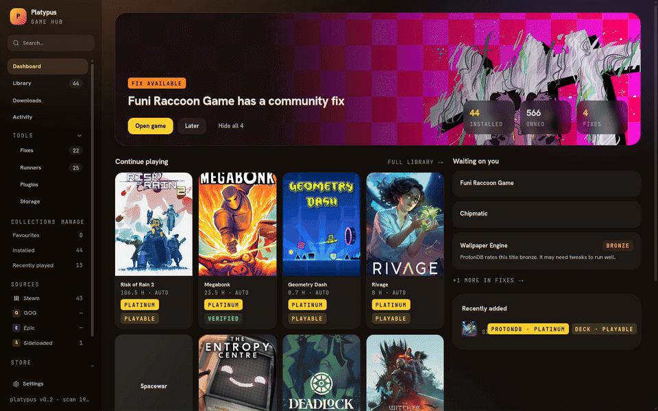
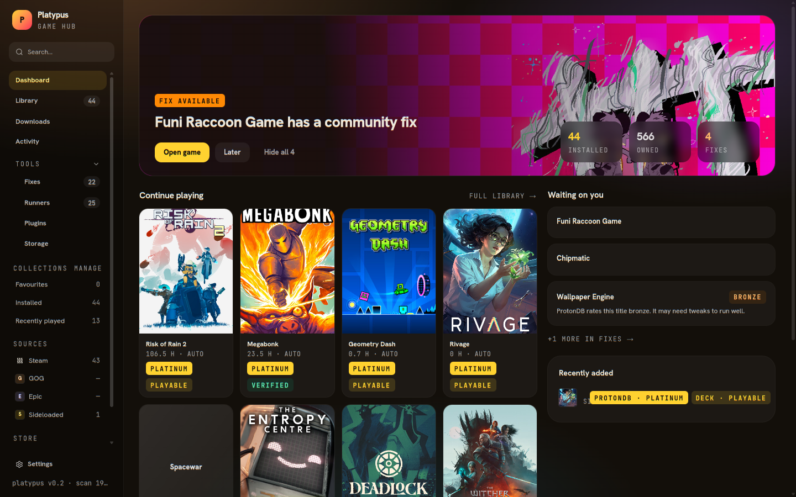
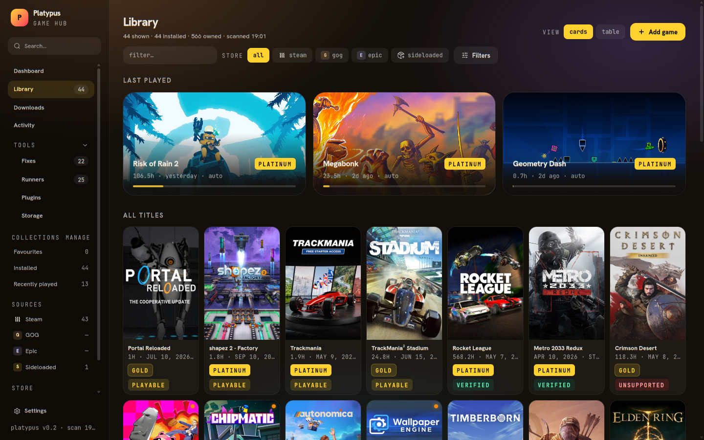
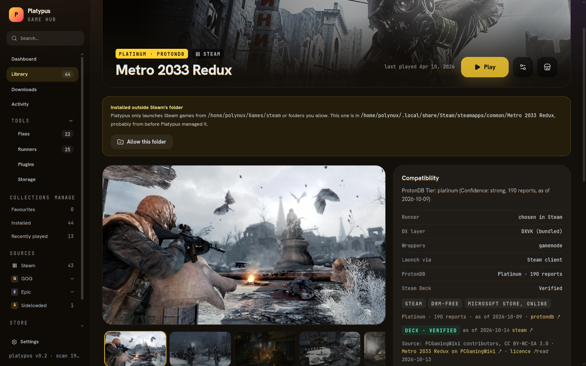

# Platypus

> [!WARNING]
> **Platypus is extremely experimental.** It is a personal project under heavy development: features
> appear and change every week, data formats can change without migration, and some store features have
> only been tested against fakes. There is no release yet. Don't trust it with anything you can't
> reinstall or redownload, and keep your official launchers around.

Platypus is a game launcher for Linux. It gathers the games you own on several stores (Steam, Epic, GOG,
Amazon, …) in one library, and runs each one with its own Proton/Wine settings, community fixes and
cloud-save handling.



| Dashboard | Library | Game page |
| --- | --- | --- |
|  |  |  |

## Why

Linux players juggle a different launcher per store, each with its own Wine setup and its own idea of
where games live. Platypus wants to be the one place for all of them:

- **One library** for every store you use, with collections, smart filters, playtime and recently played.
- **Installs without the official launchers**, where a store allows it through its own APIs and your own
  login: Platypus downloads what your account owns, nothing else. It does not bypass DRM, licence checks
  or ownership; games that need their launcher at runtime still use it.
- **Per-game runners**: Proton, Proton-GE or Wine per game, with DXVK/VKD3D, wrappers such as gamemode,
  compatibility facts from ProtonDB and the Steam Deck rating, and fix suggestions when a game crashes.
- **Stores as plugins**: each store is a small program that speaks a versioned JSON-RPC protocol
  ([docs/plugins/protocol.md](docs/plugins/protocol.md)). Anyone can add a store without touching the
  core, and a store's features live in its plugin.

## Try it

There are no packages yet: you run Platypus from a checkout. You need Linux, [Go](https://go.dev) 1.25+,
[Bun](https://bun.sh), Node.js and Python 3 (some plugins are written in Python).

```sh
git clone https://github.com/polynux/platypus-launcher.git
cd platypus-launcher
bun install        # once
bun run start      # builds and opens the app
```

Platypus keeps its data in `~/.local/share/platypus`. To try it without touching that folder, point it
somewhere else first: `PLATYPUS_DATA_DIR`, `PLATYPUS_CONFIG_DIR` and `PLATYPUS_CACHE_DIR` (see
[docs/packaging.md](docs/packaging.md)).

### Stores

The Steam plugin comes with the app and reads your library from the local Steam client. The other stores
are plugins you install from the checkout; Platypus lists a new plugin as unapproved until you approve it
in the Plugins view, then you log in from there.

| Store | Plugin | Needs | State |
| --- | --- | --- | --- |
| Steam (through the Steam client) | `steam` (bundled) | Steam | works |
| Steam (without the client) | `steam-standalone` | Python 3 | works; password login never tested on a real account |
| Epic | `epic-legendary` | [legendary](https://github.com/derrod/legendary) | works |
| GOG | `gog-gogdl` | [gogdl](https://github.com/Heroic-Games-Launcher/heroic-gogdl) | works |
| Amazon | `amazon-nile` | [nile](https://github.com/imLinguin/nile) | only tested against a fake nile |
| Test store | `echo` | nothing | fake games, for trying the UI without an account |

```sh
plugins/install.sh epic-legendary     # then approve it in Plugins
plugins/install.sh echo               # a fake store, safe to play with
```

### A sandbox with fake games

`bun run dev:sandbox` opens the app in a throwaway folder under `/tmp`, with the fake `echo` store
already logged in, a seeded library and fake games that run, fail or crash. Nothing touches your real
data. See [docs/testing.md](docs/testing.md).

## Goals and milestones

Done:

- [x] Plugin system: discovery, approval with the manifest shown first, versioned protocol (1.16), and a
      conformance suite every plugin runs through.
- [x] Store plugins end to end: library, login, install, update, uninstall, launch and session
      tracking, with a download queue (progress, pause, resume, free-space checks).
- [x] Core blocks for verify, move, install options (language, DLC), achievements, playtime and code
      redeem, checked with the test store; the real store plugins don't use them yet.
- [x] Data plugins: community fixes and tweaks in a shared format.
- [x] Epic, GOG and Amazon plugins; a plugin scaffold (`plugins/new.sh`).
- [x] Steam without the Steam client, with a Go depot downloader that spreads downloads over many CDN
      hosts (over 200 Mbps on average).
- [x] Collections and smart filters; fix suggestions from Wine/Proton crash logs.
- [x] Speed and consistency pass ("Functional & fast").
- [x] A test environment: fake programs, fake games, a sandbox and scripted end-to-end runs, so features
      are checked without a real gaming PC.

Next:

- [ ] Real store plugins on the new core blocks: verify, move, install options, achievements, redeem.
- [ ] Version selection: install an older build or a beta branch (Steam, GOG, Epic).
- [ ] Steam cloud saves, friends and chat, and Steam Families.
- [ ] Ubisoft Connect in a managed Wine prefix.
- [ ] Sandboxing store plugins with bubblewrap, enforcing the permissions they declare.
- [ ] Controller navigation.
- [ ] Packaged releases (AppImage first).

Work is tracked in [GitHub issues](https://github.com/polynux/platypus-launcher/issues); the plans live
in [docs/plans](docs/plans).

## Development

The app is a Go core (`cmd/platypus-core`) with a React + TypeScript UI (`apps/ui`) inside a desktop shell
(`apps/desktop`, Electron + Chromium). The UI talks to the core over stdio JSON-RPC through `window.platypus`;
the typed bridge is generated with `go run ./cmd/gen-ts` into `apps/ui/src/gen` (see
[docs/electron.md](docs/electron.md)).

```sh
bun install                           # once: the apps/ui and apps/desktop workspaces
bun run dev                           # desktop app with the UI from Vite (hot reload)
bun run start                         # desktop app with the built UI (builds it if missing)
bun run dev:sandbox                   # the app in a throwaway sandbox with fake games
bun run package                       # Linux AppImage (+ tar.gz) in packaging/dist
bun run test:fast                     # Go + UI + desktop tests, no network, no slow tests
bun run test:all                      # everything, slow and network tests included
PLATYPUS_TEST_SLOW=1 bun run test:e2e # scripted end-to-end runs over the sandbox
bun run typecheck                     # tsc in both apps
bun run gen-ts                        # regenerate apps/ui/src/gen after changing the core surface
```

Tests are described in [docs/testing.md](docs/testing.md).

Store plugins live in `plugins/`; `plugins/install.sh <name>` installs one into
`~/.local/share/platypus/plugins/` (set `PLATYPUS_PLUGINS` to install somewhere else), and `plugins/new.sh`
scaffolds a new one. Platypus lists a new or changed plugin as unapproved until you approve it in the Plugins
view.

The README's screenshots and tour come from `apps/desktop/scripts/readme-media.mjs`: start the app with
`PLATYPUS_REMOTE_DEBUGGING_PORT=9222 bun run start`, then run
`node apps/desktop/scripts/readme-media.mjs --port 9222 [--game <title>]`. It writes `docs/media/` (the GIF
needs ffmpeg).

## License

Platypus is released under the [Apache License 2.0](LICENSE). Copyright 2026 Guillaume Dorce.

## Third-party data

Platypus shows compatibility and protection facts it reads from other projects. Their data stays theirs:

- [ProtonDB](https://www.protondb.com): community compatibility reports, read from its public pages.
- [AreWeAntiCheatYet](https://areweanticheatyet.com): anti-cheat status of games, MIT licensed.
- [PCGamingWiki](https://www.pcgamingwiki.com): DRM and anti-cheat facts, licensed
  [CC BY-NC-SA 3.0](https://creativecommons.org/licenses/by-nc-sa/3.0/) and used here non-commercially; the
  facts are credited in the interface where they are shown.
